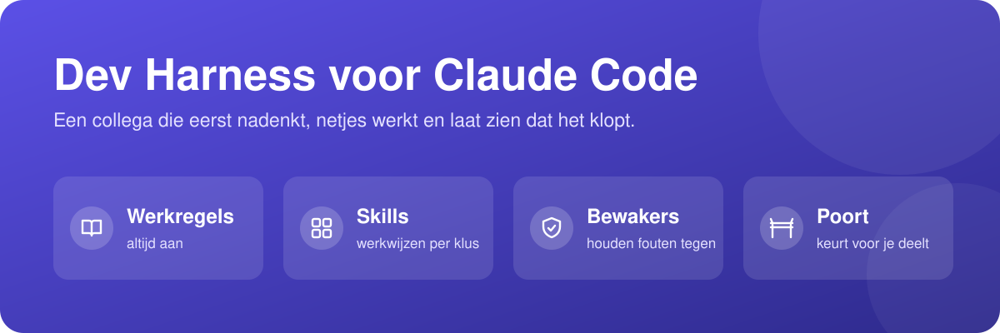
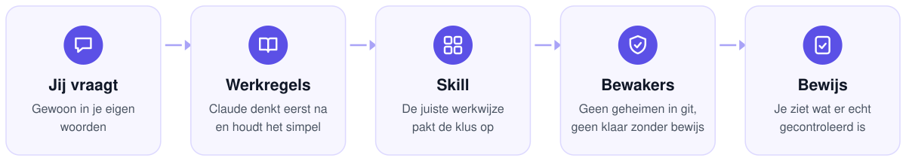
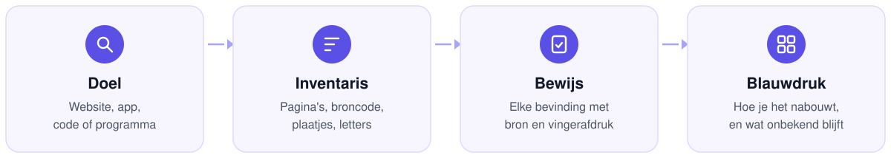
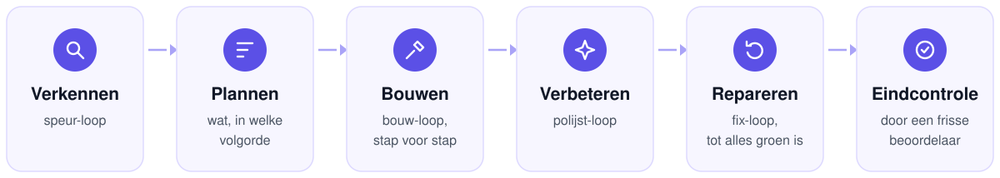
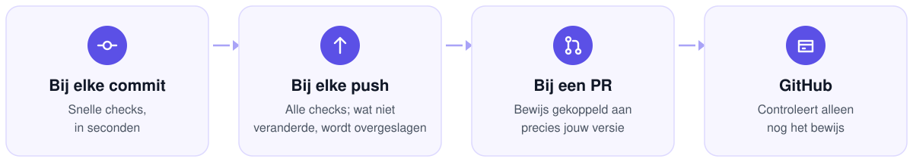

<p align="center"></p>

<p align="center">


<a href="https://github.com/robinbril/claude-code-harness/actions/workflows/ci.yml"></a>
</p>

<p align="center"><b>Van prompt tot bewezen resultaat.</b><br>Werkregels die altijd geladen zijn, 50 skills die zichzelf inzetten, hooks die afdwingen wat regels alleen vragen, en een quality gate die elk resultaat aan bewijs koppelt.</p>

## Het probleem

AI-coding agents falen voorspelbaar, en altijd op dezelfde vier manieren:

| Faalwijze | Wat er gebeurt | Wat deze harness doet |
|---|---|---|
| **Stille aannames** | De agent kiest een interpretatie en bouwt erop door zonder te checken | Aannames worden benoemd; bij echte twijfel vraagt Claude eerst |
| **Overengineering** | Abstracties, opties en lagen waar niemand om vroeg | De simpelste oplossing die de eis volledig haalt, niets speculatiefs |
| **Scope-drift** | Ongevraagde wijzigingen naast de taak maken elke diff onreviewbaar | Chirurgische wijzigingen: elke regel is herleidbaar naar het verzoek |
| **Onbewezen "klaar"** | Succes geclaimd zonder dat er iets gedraaid is | Een klaar-claim na een wijziging vraagt `VERIFIED:` met een geslaagde check daarna, of een eerlijke `UNVERIFIED:`; een hook blokkeert al het andere |

## Wat je krijgt

| Laag | Wat het afdwingt |
|---|---|
| **Werkregels** | Tien regels in `guidelines/CLAUDE.md`, bij elke sessie geladen: denken voor bouwen, minimale diffs, verplicht bewijs, modelrouting |
| **50 skills** | Beproefde methodes per type werk, van root-cause debugging tot autonome build-loops. Claude kiest zelf, of jij roept aan met `/naam` |
| **3 hooks** | Deterministische bewaking buiten het model om: secrets uit commits, geen klaar-claim zonder bewijs |
| **poort** | Quality gate voor je eigen repo's: checks per commit en push, en een PR-gate die bewijs aan de exacte commit bindt |



## Installeren

**Als plugin** (Claude Code 2.1.275 of nieuwer):

```
/plugin install dev-harness --marketplace robinbril/claude-code-harness
```

**Of met het installatiescript**, als je de bestanden in je eigen `~/.claude` wilt:

```bash
git clone https://github.com/robinbril/claude-code-harness.git
cd claude-code-harness
bash install.sh
```

Windows: `powershell -ExecutionPolicy Bypass -File .\install.ps1`. Beide scripts maken eerst een back-up van wat ze vervangen. Herstart Claude Code daarna.

| | Plugin | Script |
|---|---|---|
| Skills | Automatisch | Naar `~/.claude/skills/` |
| Werkregels | Via een `SessionStart`-hook | Worden `~/.claude/CLAUDE.md` |
| Hooks | Direct actief via `hooks/hooks.json` | Merge `examples/settings.json` in `~/.claude/settings.json` |

## Uitgelicht: `/rea`

**Reverse engineering met bewijs.** `/rea` laat Claude een website, applicatie, JavaScript-bundel of binary ontleden met [REA](https://github.com/morluto/rea) van morluto (MIT). Het resultaat is een dossier met herleidbare bevindingen en een reconstructie-blauwdruk, geen giswerk.



| Input | Output |
|---|---|
| `/rea https://voorbeeld.nl` | Alle publieke routes, design-tokens, fonts, assets, responsive regels, motion en formulierlogica, met expliciete gaten |
| `/rea ./MijnApp.app` of een Electron-app | Statisch gereconstrueerde applicatiestructuur en een diff tussen versies |
| `/rea firmware.bin` of een APK | Native en Android-analyse: decompilatie, resources, call-tracing |

- **Zero-install.** Draait REA 6.4.0 via `npx`; alleen Node.js en npm nodig.
- **Evidence-first.** Elke bevinding met URL, SHA-256 en Evidence ID. Waargenomen, afgeleid en onbekend blijven strikt gescheiden.
- **Veilig.** Verstuurt nooit formulieren of berichten om gedrag te testen.
- **Sneller als MCP-server**, zie [MCP-servers](#mcp-servers).

## Werkregels

`guidelines/CLAUDE.md`, tien secties:

1. **Think before coding.** Aannames benoemen, afwegingen zichtbaar maken, bij twijfel vragen.
2. **Simplicity first.** De minimale code die het probleem volledig oplost.
3. **Surgical changes.** Alleen aanraken wat de taak vraagt.
4. **Goal-driven execution.** Elke taak wordt een toetsbaar succescriterium.
5. **Verify before "done".** `VERIFIED:` met echte output, of eerlijk `UNVERIFIED:`.
6. **Look it up.** Identifiers, call-sites en conventies lezen voor je typt.
7. **Structure.** Bestanden 200 tot 400 regels, 800 als harde grens; per feature groeperen.
8. **Model routing.** Opus voor oordeel, Sonnet voor bouwwerk, Haiku voor zoeken en logs.
9. **Before irreversible steps.** Eerst `BLAST RADIUS`; nooit autonoom committen of pushen.
10. **Compacting.** Wat bewaard blijft bij samenvatten, en wat niet.

## Hoe je ziet dat het werkt

- Claude stelt een gerichte vraag waar het eerder zou gokken.
- Diffs worden kleiner en raken alleen wat gevraagd is.
- Elke klaar-melding eindigt met een `VERIFIED:`-regel: welk commando, welke output.
- Een commit met een API-key wordt geblokkeerd voordat hij in de geschiedenis staat.

**Trade-off:** de regels kiezen voor zorgvuldigheid boven snelheid. Voor triviale taken gebruikt Claude eigen oordeel; voor alles wat in productie belandt, wint discipline.

## Skills

Elke skill activeert automatisch op zijn onderwerp, of roep hem aan met `/naam` (via de plugin: `/dev-harness:naam`).

### Methodiek en beslissen

| Skill | Waarvoor |
|---|---|
| `rea` | Reverse engineering van sites, apps, bundels en binaries, met bewijsketen |
| `skill-finder` | Eerst checken of een skill al bestaat, hier of upstream, voor je iets bouwt |
| `systematic-debugging` | Root cause in vier fasen: reproduceren, isoleren, fixen, verifiëren |
| `council` | Zware, moeilijk omkeerbare beslissingen via onafhankelijke adviseurs, blinde peer-review en synthese |
| `batch-grill-me` | Een plan doorvragen tot elke beslissing genomen is, alle open vragen per ronde tegelijk |
| `projectstructuur` | Repo-indeling ontwerpen, veilig herstructureren en bewaken |

### Kwaliteit en git

| Skill | Waarvoor |
|---|---|
| `find-bugs` | Bugs, security-gaten en kwaliteitsproblemen in de branch-diff |
| `code-audit` | Volledige codereview: open-code-review bepaalt dekking en regels, Claude reviewt. Vereist `ocr` (`npm install -g @alibaba-group/open-code-review`) |
| `commit-discipline` | Geen commit-spam: werk verzamelen, op signaal drie tot zeven thematische commits |
| `repo-hygiene` | Read-only audit: branch-drift, dode branches, merge-conflicten, open PR's, falende Actions |
| `render-proof` | Headless render naar PNG om een UI-claim visueel te bewijzen |

### Autonome loops



`keten-loop` rijgt de loops aan elkaar; elke loop werkt ook standalone.

| Skill | Waarvoor |
|---|---|
| `/goal` | Geef een uitkomst; de sessie werkt er zelfstandig naartoe, met bewijs per stap |
| `supergoal` | Grote taken in fasen, elke fase gegated door een onafhankelijke evaluator |
| `keten-loop` | End-to-end: verkennen, plannen, bouwen, polijsten, fixen, eindcheck |
| `bouw-loop` | Een feature of backlog story voor story bouwen |
| `polijst-loop` | Itereren tegen een rubric tot de score plateaut |
| `fix-loop` | Een falend commando groen krijgen zonder tests aan te passen |
| `speur-loop` | Bug-hunting in rondes tot er niets nieuws meer bijkomt |
| `waak-loop` | Wachten op externe state (CI, deploy, DNS) en bij verandering handelen |
| `createloopprompt` | Een taak omzetten in een begrensde loop-prompt voor Claude Code, Codex of Cursor |

### Frontend-design

| Skill | Waarvoor |
|---|---|
| `design-taste-frontend` | Anti-slop: audit-first, een eigen design-systeem per brief |
| `redesign-existing-projects` | Een bestaand product opwaarderen zonder functionaliteit te breken |
| `emil-design-eng` | UI-polish, animatiekeuzes en de onzichtbare details |
| `make-interfaces-feel-better` | Schaduw, typografie en micro-interacties die een interface af maken |
| `ux-heuristics` | Usability-audit volgens Nielsen, Krug en cognitive walkthrough |
| `frontend-gotchas` | Terugkerende frontend-valkuilen voor ze in je code belanden |
| `fixing-accessibility` | Toegankelijkheid auditen en fixen: ARIA, toetsenbord, focus, contrast |
| `transitions-dev` | Productieklare CSS-transities voor dropdowns, modals, toasts en tabs |

### Motion design, door Emil Kowalski

| Skill | Waarvoor |
|---|---|
| `animate` | Een animatie vanaf nul in de volgorde die bepaalt of hij goed voelt: noodzaak, doel, tool, curve, duur |
| `animate-expo` | Hetzelfde voor React Native en Expo: threads, springs, gesture-overdracht |
| `animation-vocabulary` | Een vage omschrijving van beweging vertalen naar de juiste term |
| `apple-design` | Apple's fysieke, vloeiende interactiemodel vertaald naar het web |
| `ask-sonner` | Sonner, de React-toastbibliotheek: setup, promise-toasts, styling |
| `find-animation-opportunities` | Waar beweging iets toevoegt, en waar niet, met exacte waarden |
| `improve-animations` | Audit van alle animatiecode, met geprioriteerde uitvoerplannen |
| `review-animations` | Animatiecode keuren tegen een hoge vakmanschapslat |
| `mobile-native` | Een web-app native laten voelen op mobiel: tap-states, viewport, inputs |
| `pick-ui-library` | De juiste UI-bibliotheek uit een gecureerde lijst (alleen op verzoek) |
| `prototype` | Meerdere echt verschillende varianten achter een switcher, de beste wint (alleen op verzoek) |

### End-to-end testen

| Skill | Waarvoor |
|---|---|
| `e2e` | Agentische end-to-end-tests voor web en mobiel met [e2e](https://github.com/tester-army/e2e) |
| `e2e-rules` | Huisregels: wanneer een test verplicht is, naamgeving, config, definition of done |

### Documenten en visuals

| Skill | Waarvoor |
|---|---|
| `office-docs` | PowerPoint, Excel en Word programmatisch genereren |
| `brandkit` | Merkidentiteit en brand-guidelines-boards |
| `data-visualization` | Het juiste charttype vanuit de relatie in je data |
| `diagram-design` | Architectuur-, flow- en procesdiagrammen als HTML/SVG |
| `readme` | README en repo-omschrijving die in tien seconden overtuigen: verhaallijn, eigen SVG-visuals voor licht en donker, gerenderd met GitHub's eigen engine. Deze pagina is ermee gebouwd |

### PolpoHire en The Staffing Society

| Skill | Waarvoor |
|---|---|
| `polpohire-design` | PolpoHire-schermen in de actuele designtaal: tokens, componenten, motion |
| `bi-dashboards` | Power BI-niveau rapportage in een eigen Vue-app met ECharts |
| `theme-selector` | De PolpoHire/TSS-themakiezer: presets, eigen kleuren, typografie, dichtheid |
| `pre-pr-gates` | Harde PR-gates: ghost versions, geslikte DB-fouten, ontbrekende org_id-tests, verouderde PR-tekst |

## Commando's

| Commando | Wat |
|---|---|
| `/rea <doel>` | Reverse engineering met bewijsdossier en reconstructie-blauwdruk |
| `/readme` | README en repo-omschrijving bouwen of herontwerpen, inclusief visuals |
| `/goal <uitkomst>` | Autonoom naar een uitkomst; `ga door` hervat een lopende run |
| `/supergoal` | Zwaarste variant: gefaseerd plan, onafhankelijke evaluator per fase |
| `/keten-loop` | Token-zuinige keten van verkennen tot eindcheck |
| `/batch-grill-me` | Doorvragen tot elke beslissing in een plan genomen is |
| `/council` | Meerdere adviseurs, blinde peer-review, een synthese |
| `/find-bugs` | Bugs en security-gaten in je branch-diff |
| `/code-audit` | Volledige codereview met dekking tegen de hele git-inventaris |
| `/repo-hygiene` | Repo-gezondheid zonder iets te wijzigen |
| `/pre-pr-gates` | Alle gates lopen voor `gh pr create` |

## Hooks

Deterministische scripts die op vaste momenten in Claude Code meedraaien, onafhankelijk van wat het model besluit. Vereisen Node.js.

| Hook | Moment | Effect |
|---|---|---|
| `guidelines` | `SessionStart` (plugin) | Laadt `guidelines/CLAUDE.md` als context, omdat een plugin geen eigen `CLAUDE.md` kan meeleveren |
| `commit-guard` | `PreToolUse` op `git commit` | Blokkeert secrets, API-keys en temp-bestanden (`.env`, `*.tmp`, `*.bak`); waarschuwt bij e-mailadressen. Eigen patronen via `.harness-blocklist` |
| `verified-claim-guard` | `Stop` | Blokkeert een klaar-claim na een muterende beurt zonder echte tool-observatie; `UNVERIFIED:` mag altijd |

Twee instellingen ontbreken bewust in `examples/settings.json`: `defaultMode: auto` slaat permissie-prompts over, en `remoteControlAtStartup` koppelt elke sessie aan Remote Control. Beide verdienen een eigen, bewuste keuze.

## MCP-servers

Optioneel en per project te kiezen. Kopieer [`examples/mcp.json`](examples/mcp.json) naar `.mcp.json` in je project, of voeg ze los toe:

| Server | Waarvoor | Toevoegen |
|---|---|---|
| `chrome-devtools` | Pagina's inspecteren: console, netwerk, performance | `claude mcp add chrome-devtools -- npx -y chrome-devtools-mcp@1.11.0 --isolated` |
| `playwright` | Browserflows aansturen en screenshotten | `claude mcp add playwright -- npx -y @playwright/mcp@0.0.83` |
| `e2e` | De app live besturen en e2e-tests schrijven | `claude mcp add e2e -- npx -y e2e@0.21.2 mcp` |
| `terminal` | Interactieve sessies: REPL's, prompts, langlopende processen | `claude mcp add terminal -- npx -y mcp-interactive-terminal@1.0.9` |
| `rea` | Reverse engineering als native tools | `claude mcp add rea -- npx -y rea-agents@6.4.0 --mcp` |
| `supabase` | Database, storage en docs van je Supabase-project | `claude mcp add --transport http supabase "https://mcp.supabase.com/mcp?project_ref=JOUW_PROJECT_REF&features=database,storage,docs"` |

Alle versies zijn gepind; updaten is een bewuste stap. Claude in Chrome (je ingelogde browser) en connectors als Gmail en Outlook beheer je in je claude.ai-account.

## poort

`tools/poort/` is poort v0.4.0: een quality gate in één bestand, zonder dependencies.



Installeren in een repo: `node <pad-naar-deze-harness>/tools/poort/poort.mjs init`. Daarna:

| Commando | Wat |
|---|---|
| `node .poort/poort.mjs doctor` | Welke tools per check ontbreken en of je stack draait |
| `node .poort/poort.mjs run push` | Alle push-checks; ongewijzigde checks komen uit de cache |
| `node .poort/poort.mjs verify` | Controleert na je commit of elke verplichte check bewijs heeft voor exact die commit; `run push` levert dat bewijs |
| `node .poort/poort.mjs e2e --record` | E2E-stappen opnieuw opnemen na een bewuste UI-wijziging |

E2E-opnames draaien op je eigen Claude-seat: geen API-keys, geen proxy. Details per check en profiel: [`tools/poort/README.md`](tools/poort/README.md).

## Onderhoud en CI

Overnemen, onderhouden, herstructureren en opschonen per onderwerp: [`docs/ONDERHOUD.md`](docs/ONDERHOUD.md).

Elke PR en push naar `main` draait CI: skill-namen en frontmatter, dekking van elke skill in deze README en `docs/ONDERHOUD.md`, versie- en hook-consistentie, geen persoonlijke paden, syntax van alle scripts, README-visuals reproduceerbaar uit `assets/visuals.json`, de volledige poort-testsuite en de repo-hygiene-e2e.

## Statusline (optioneel)

Context-gebruik, actieve tools, agents en voortgang in je statusbalk: [claude-hud](https://github.com/jarrodwatts/claude-hud) van Jarrod Watts.

```
/plugin install claude-hud
/claude-hud:setup
```

## Herkomst en licenties

| Onderdeel | Bron | Licentie |
|---|---|---|
| Methodiek-basis | [Superpowers](https://github.com/obra/superpowers) v5.1.0 van Jesse Vincent | MIT (zie `LICENSE`) |
| `find-bugs` | [getsentry/skills](https://github.com/getsentry/skills) | Apache-2.0 |
| `make-interfaces-feel-better` | [jakubkrehel](https://github.com/jakubkrehel/make-interfaces-feel-better) | MIT |
| `e2e` | [tester-army/e2e](https://github.com/tester-army/e2e) | Apache-2.0, met NOTICE |
| `fixing-accessibility` | [ibelick/ui-skills](https://github.com/ibelick/ui-skills) | MIT |
| `transitions-dev` | [Jakubantalik/transitions-dev](https://github.com/Jakubantalik/transitions-dev) | MIT |
| `emil-design-eng` en de motion-skills | Emil Kowalski | MIT |
| `batch-grill-me` | gebaseerd op grilling uit [mattpocock/skills](https://github.com/mattpocock/skills) | MIT |
| `code-audit` | gebaseerd op open-code-review-delegate uit [alibaba/open-code-review](https://github.com/alibaba/open-code-review), aangepast (zie `NOTICE`) | Apache-2.0 |
| `rea` | eigen skill rond [morluto/rea](https://github.com/morluto/rea) 6.4.0, met de upstream-instructies in `references/upstream/` | MIT |
| `readme` | eigen skill; de verhaallijn (probleem, bewijs dat het werkt, trade-off) volgt [andrej-karpathy-skills](https://github.com/forrestchang/andrej-karpathy-skills) | MIT |
| `tools/poort/` | Reforge Recruitment | Niet MIT: `UNLICENSED`, alle rechten voorbehouden; inzien mag, hergebruik alleen met toestemming |

Overgenomen skills hebben hun licentie in hun eigen map. `polpohire-design`, `bi-dashboards`, `theme-selector` en `pre-pr-gates` zijn gebouwd voor PolpoHire en The Staffing Society; de rest is generiek.
