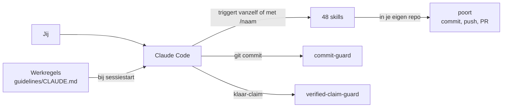
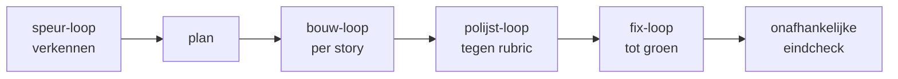
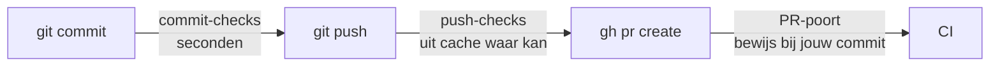

# Dev Harness voor Claude Code


[](https://github.com/robinbril/claude-code-harness/actions/workflows/ci.yml)

Een compacte harness voor Claude Code: werkregels die altijd aan staan, 48 skills die vanzelf triggeren, drie hooks die bewaken, en poort als kwaliteitspoort voor je eigen repo's. Gebouwd op [Superpowers](https://github.com/obra/superpowers) van Jesse Vincent (MIT). Alleen skills die echt gebruikt worden zitten erin; samen kosten hun beschrijvingen ongeveer 5.000 tokens per sessie.

## In een oogopslag



| Onderdeel | Wat het doet |
|---|---|
| Werkregels | Denk voor je codeert, simpel, chirurgisch, verifieer voor "klaar", structuur, modelrouting, BLAST RADIUS |
| Skills | Methodiek, kwaliteit, loops, frontend, animatie, e2e, documenten, PolpoHire en TSS |
| Hooks | Blokkeren secrets in commits en een klaar-claim zonder bewijs; laden de werkregels via de plugin |
| poort | Checks voor elke commit en push, en een PR-poort die bewijs aan precies jouw commit koppelt |

## Installeren

**Als plugin** (Claude Code 2.1.275 of nieuwer):

```
/plugin install dev-harness --marketplace robinbril/claude-code-harness
```

**Met het script**, na `git clone https://github.com/robinbril/claude-code-harness.git`:

```bash
bash install.sh
```

Op Windows: `powershell -ExecutionPolicy Bypass -File .\install.ps1`. Beide scripts maken back-ups van wat ze vervangen. Herstart Claude Code daarna.

| Route | Skills | Werkregels | Hooks |
|---|---|---|---|
| Plugin | automatisch | via de `SessionStart`-hook | automatisch via `hooks/hooks.json` |
| Script | naar `~/.claude/skills/` | `guidelines/CLAUDE.md` naar `~/.claude/CLAUDE.md` | merge `settings.example.json` in `~/.claude/settings.json` |

## Werkregels

`guidelines/CLAUDE.md`, in tien secties:

1. **Think before coding:** aannames benoemen, bij twijfel vragen.
2. **Simplicity first:** de minste code die het probleem oplost.
3. **Surgical changes:** alleen aanraken wat de taak vraagt.
4. **Goal-driven execution:** taken omzetten in toetsbare doelen.
5. **Verify before "done":** `VERIFIED:` met echte output, of eerlijk `UNVERIFIED:`.
6. **Look it up:** identifiers, call-sites en conventies lezen voor je typt.
7. **Structure:** bestanden 200 tot 400 regels, 800 als harde grens; per feature groeperen in nieuwe projecten.
8. **Models:** Opus voor oordeel, Sonnet voor bouwwerk, Haiku voor zoeken en logs.
9. **Before irreversible steps:** eerst `BLAST RADIUS`, nooit zelf committen of pushen.
10. **Compacting:** wat je bewaart en wat je weglaat bij samenvatten.

## Skills

Elke skill triggert vanzelf op zijn onderwerp, of start hem met `/<naam>`.

### Methodiek en beslissen

| Skill | Wanneer |
|---|---|
| `skill-finder` | Eerst checken of er al een skill bestaat voor je iets bouwt |
| `systematic-debugging` | Bug reproduceren, isoleren, fixen, verifieren |
| `council` | Een zware, moeilijk omkeerbare keuze laten uitvechten door meerdere adviseurs |
| `batch-grill-me` | Een plan of keuze laten doorvragen, alle open vragen per ronde tegelijk |
| `projectstructuur` | Een repo-indeling ontwerpen, veilig herstructureren en bewaken |

### Kwaliteit en git

| Skill | Wanneer |
|---|---|
| `find-bugs` | Bugs, security-gaten en kwaliteitsproblemen in de branch-diff vinden |
| `code-audit` | Volledige codereview: de open-code-review-CLI kiest bestanden en regels, Claude reviewt zelf. Vereist `ocr` (`npm install -g @alibaba-group/open-code-review`) |
| `commit-discipline` | Geen commit-spam: werk verzamelen, op signaal 3 tot 7 thematische commits |
| `repo-hygiene` | Read-only check: drift, dode branches, merge-conflicten, open PR's, falende Actions |
| `render-proof` | Een pagina headless renderen naar PNG en het verwachte feit aflezen |

### Loops en autonoom bouwen



Zo rijgt `keten-loop` de loops aan elkaar. Elke loop werkt ook los.

| Skill | Wanneer |
|---|---|
| `/goal` | Een uitkomst geven; de sessie werkt er zelfstandig naartoe met bewijs per stap |
| `supergoal` | Een grote taak autonoom plannen en bouwen, met een onafhankelijke check per fase |
| `keten-loop` | Een einddoel end-to-end: verkennen, plannen, bouwen, polijsten, fixen, eindcheck |
| `bouw-loop` | Een feature of takenlijst story voor story bouwen |
| `polijst-loop` | Een bestaande versie verbeteren tegen een rubric tot de score plateaut |
| `fix-loop` | Een falend commando groen krijgen zonder tests aan te passen |
| `speur-loop` | Bugs zoeken in rondes tot er niets nieuws meer bij komt |
| `waak-loop` | Wachten op externe state (CI, deploy, DNS) en bij verandering handelen |
| `createloopprompt` | Een taak omzetten in een begrensde loop-prompt voor Claude Code, Codex of Cursor |

### Frontend-design

| Skill | Insteek |
|---|---|
| `design-taste-frontend` | Anti-slop: audit-first, eigen design-systeem per brief |
| `redesign-existing-projects` | Een bestaand project opwaarderen zonder functionaliteit te breken |
| `emil-design-eng` | UI-polish, animatiekeuzes en de onzichtbare details |
| `make-interfaces-feel-better` | Details die een interface verzorgd laten voelen: schaduw, typografie, micro-interacties |
| `ux-heuristics` | Usability-audit: Nielsen, Krug, cognitive walkthrough |
| `frontend-gotchas` | Terugkerende frontend-valkuilen voor je ze inbouwt |
| `fixing-accessibility` | Toegankelijkheid auditen en fixen: ARIA, toetsenbord, focus, contrast, formulierfouten |
| `transitions-dev` | Kant-en-klare CSS-transities: dropdowns, modals, badges, toasts, tabs |

### Animatie en beweging (Emil Kowalski)

| Skill | Wanneer |
|---|---|
| `animate` | Een animatie van nul opbouwen, in de volgorde die bepaalt of hij goed voelt: moet hij er zijn, doel, tool, curve, duur |
| `animate-expo` | Hetzelfde voor React Native en Expo: thread, spring of timing, overdracht van gestures |
| `animation-vocabulary` | Een vage omschrijving van beweging omzetten in de juiste term ("het verende ding bij een popover" is pop in) |
| `apple-design` | Apple's aanpak van interfaces en vloeiende, fysieke beweging, vertaald naar het web: springs, gestures, sheets |
| `ask-sonner` | Sonner, de React-toastbibliotheek: opzetten, promise- en laad-toasts, stijl en positie |
| `find-animation-opportunities` | Plekken vinden die zouden moeten bewegen, en afwijzen wat niet moet; stelt exacte waarden voor |
| `improve-animations` | Audit van alle animatiecode met geprioriteerde, losse uitvoerplannen voor andere agents |
| `review-animations` | Animatiecode keuren tegen een hoge vakmanschapslat; goedkeuring moet verdiend worden |
| `mobile-native` | Een web-app native laten voelen op een telefoon: hover, tap-flits, de 100vh-bug, inzoomende inputs |
| `pick-ui-library` | De juiste bibliotheek kiezen voor een frontendtaak uit een gecureerde lijst (alleen op verzoek) |
| `prototype` | Meerdere echt verschillende versies van een UI-stuk bouwen achter een kiezer, en de beste promoveren (alleen op verzoek) |

### E2E-tests

| Skill | Wanneer |
|---|---|
| `e2e` | Agentische end-to-end-tests voor web en mobiel met [e2e](https://github.com/tester-army/e2e) |
| `e2e-rules` | Huisregels: wanneer een test nodig is, naamgeving, config-template, wanneer klaar |

### Documenten en visuals

| Skill | Wanneer |
|---|---|
| `office-docs` | PowerPoint, Excel en Word programmatisch maken |
| `brandkit` | Merkidentiteit en brand-guidelines-boards, geen UI-code |
| `data-visualization` | Grafiektype kiezen uit de data-relatie voor je een chart bouwt |
| `diagram-design` | Architectuur-, flow- en andere diagrammen als HTML/SVG |

### PolpoHire en The Staffing Society

| Skill | Wanneer |
|---|---|
| `polpohire-design` | Een PolpoHire-scherm bouwen of herstijlen in de huidige designtaal: tokens, componenten, beweging |
| `bi-dashboards` | Rapporten en dashboards in Power BI-stijl in een eigen Vue-app met ECharts, zonder Power BI |
| `theme-selector` | De PolpoHire/TSS-themakiezer nabouwen: presets, eigen kleuren, lettertype, dichtheid, matglas |
| `pre-pr-gates` | Harde poorten voor elke PR: ghost versions, geslikte DB-fouten, ontbrekende org_id-tests, verouderde PR-tekst |

## Commando's

**Slash-commando's** die je het vaakst typt:

| Commando | Wat |
|---|---|
| `/goal <uitkomst>` | Werkt zelfstandig naar een uitkomst; `ga door` hervat een lopende run |
| `/supergoal` | Zwaarste variant: plan, fasen, onafhankelijke evaluator per fase |
| `/keten-loop` | Token-zuinige end-to-end keten van verkennen tot eindcheck |
| `/batch-grill-me` | Doorvragen tot elke beslissing in een plan genomen is |
| `/council` | Meerdere adviseurs, blinde peer-review en een synthese |
| `/find-bugs` | Bugs en security-gaten in je branch-diff |
| `/code-audit` | Volledige codereview met dekking tegen de hele git-inventaris |
| `/repo-hygiene` | Gezondheid van de repo zonder iets te wijzigen |
| `/pre-pr-gates` | De poorten lopen voor je `gh pr create` doet |

**poort** in een repo, na `node <harness>/tools/poort/poort.mjs init`:

| Commando | Wat |
|---|---|
| `node .poort/poort.mjs doctor` | Welke tools per check ontbreken en of je stack draait |
| `node .poort/poort.mjs run push` | Alle push-checks; ongewijzigde checks komen uit de cache |
| `node .poort/poort.mjs verify` | Bewijs voor de PR-poort, gekoppeld aan je commit |
| `node .poort/poort.mjs e2e --record` | E2E-stappen opnieuw opnemen na een bewuste UI-wijziging |

## Hooks

| Hook | Wanneer | Wat |
|---|---|---|
| `guidelines` | `SessionStart` (plugin) | Laadt `guidelines/CLAUDE.md` als context, omdat een plugin geen eigen `CLAUDE.md` meelevert |
| `commit-guard` | `PreToolUse` op `git commit` | Blokkeert secrets, API-keys en temp-bestanden (`.env`, `*.tmp`, `*.bak`, `__pycache__`); waarschuwt bij e-mailadressen en em-dashes. Eigen patronen in `.harness-blocklist` |
| `verified-claim-guard` | `Stop` | Blokkeert een klaar-claim na een muterende beurt zonder echte tool-observatie; `UNVERIFIED:` mag altijd |

De hooks hebben `node` nodig. `defaultMode: auto` en `remoteControlAtStartup` staan er expres niet in `settings.example.json`: die slaan permissie-prompts over en zijn een bewuste, losse keuze.

## Aanbevolen MCP-servers

Geen onderdeel van de plugin: kies zelf welke je aanzet. Kopieer [`.mcp.example.json`](.mcp.example.json) naar `.mcp.json` in je project, of voeg ze per stuk toe:

| Server | Waarvoor | Toevoegen |
|---|---|---|
| `chrome-devtools` | Pagina's inspecteren, console en netwerk lezen, prestaties meten | `claude mcp add chrome-devtools -- npx -y chrome-devtools-mcp@1.11.0 --isolated` |
| `playwright` | Een browser besturen voor flows en screenshots | `claude mcp add playwright -- npx -y @playwright/mcp@0.0.83` |
| `e2e` | De app live besturen en e2e-tests schrijven (hoort bij skill `e2e`) | `claude mcp add e2e -- npx -y e2e@0.21.2 mcp` |
| `terminal` | Interactieve terminalsessies (REPL's, prompts, langlopende processen) | `claude mcp add terminal -- npx -y mcp-interactive-terminal@1.0.9` |
| `supabase` | Database, storage en docs van je Supabase-project | `claude mcp add --transport http supabase "https://mcp.supabase.com/mcp?project_ref=JOUW_PROJECT_REF&features=database,storage,docs"` |

Versies staan vast; werk ze bewust bij. Buiten de config: Claude in Chrome is een browserextensie voor je ingelogde browser, en connectors als Gmail en Outlook zet je aan in je claude.ai-account.

## poort

`tools/poort/` is poort v0.4.0, een bestand zonder dependencies:



Installeren in een repo: `node <pad-naar-deze-harness>/tools/poort/poort.mjs init`, daarna `doctor`. `e2e-rules` gebruikt de Claude-seat-koppeling van poort, zodat e2e op je eigen abonnement draait. Uitleg per check en profiel: [`tools/poort/README.md`](tools/poort/README.md).

## Onderhoud en CI

Overnemen per onderwerp, onderhoud, herstructureren en opschoning: [`ONDERHOUD.md`](ONDERHOUD.md).

Bij elke PR en push naar `main` controleert CI (`.github/workflows/ci.yml`): elke skill heeft een naam gelijk aan zijn map en staat in deze README en in `ONDERHOUD.md`, versies en hooks kloppen, geen persoonlijke paden, de syntax van alle scripts, de poort-tests en de repo-hygiene-tests.

## Statusline (optioneel)

Context-gebruik, actieve tools, agents en todo-voortgang in je statusbalk: [claude-hud](https://github.com/jarrodwatts/claude-hud) van Jarrod Watts.

```
/plugin install claude-hud
/claude-hud:setup
```

## Herkomst en licenties

| Onderdeel | Bron | Licentie |
|---|---|---|
| Methodiek-basis | [Superpowers](https://github.com/obra/superpowers) v5.1.0 | MIT (zie `LICENSE`) |
| `find-bugs` | [getsentry/skills](https://github.com/getsentry/skills) | Apache-2.0 |
| `make-interfaces-feel-better` | [jakubkrehel](https://github.com/jakubkrehel/make-interfaces-feel-better) | MIT |
| `e2e` | [tester-army/e2e](https://github.com/tester-army/e2e) | Apache-2.0, met NOTICE |
| `fixing-accessibility` | [ibelick/ui-skills](https://github.com/ibelick/ui-skills) | MIT |
| `transitions-dev` | [Jakubantalik/transitions-dev](https://github.com/Jakubantalik/transitions-dev) | MIT |
| `emil-design-eng` en de animatieskills | Emil Kowalski (officiele skillset) | MIT |
| `batch-grill-me` | gebaseerd op grilling uit [mattpocock/skills](https://github.com/mattpocock/skills) | MIT |
| `code-audit` | gebaseerd op open-code-review-delegate uit [alibaba/open-code-review](https://github.com/alibaba/open-code-review), aangepast (zie `NOTICE`) | Apache-2.0 |
| `tools/poort/` | Reforge Recruitment | niet MIT: `UNLICENSED`, alle rechten voorbehouden; inzien mag, hergebruik alleen met toestemming |

Overgenomen skills hebben hun licentie in de skill-map. De meeste skills zijn generiek; `polpohire-design`, `bi-dashboards`, `theme-selector` en `pre-pr-gates` zijn gemaakt voor PolpoHire en The Staffing Society. Weggelaten uit Superpowers: de dev-zwaardere multi-step skills en de multi-harness setup, om het rustig en Claude-Code-gericht te houden.
