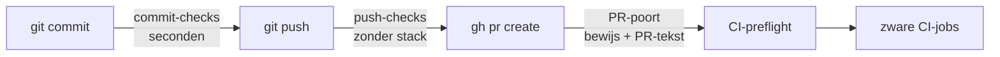
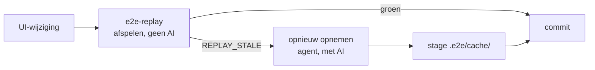
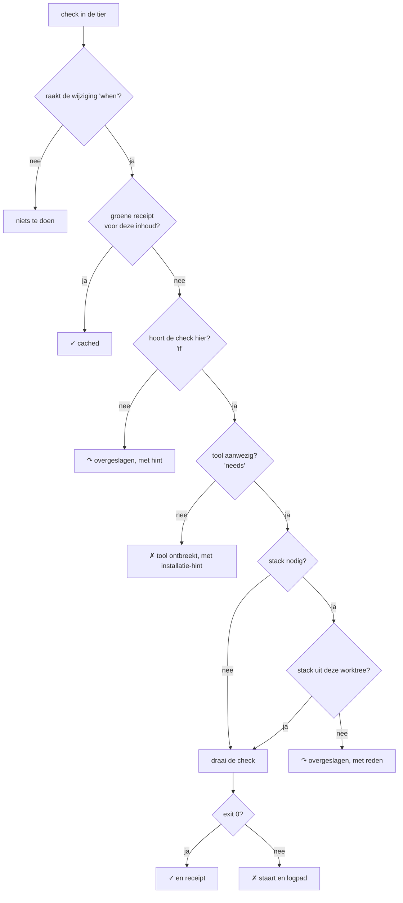
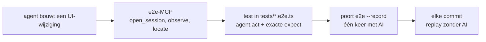

# poort

poort is een quality gate voor git-hooks en agentic e2e-tests, voor jou en voor je agents (Claude Code, Codex, Cursor). Het draait goedkope checks vóór je commit en push, onthoudt welke inhoud al groen was, test alleen tegen een stack uit je eigen worktree en blokkeert `gh pr create` tot het bewijs bij precies jouw code hoort. Het is één bestand zonder dependencies en werkt in elke git-repo met Node.js of Python.

## Waarom poort bestaat

In repo's waar mensen en agents naast elkaar committen, keren drie problemen steeds terug:

- **Goedkope fouten bereiken CI**: runs falen op checks die lokaal te reproduceren waren (tests, typecheck, lint), en elke zo'n run kost de volle CI-tijd
- **Een groene hook bewijst weinig**: een hook die tegen `localhost` test, test met meerdere worktrees vaak andere code dan je commit
- **Bewijs hangt aan een bestand, niet aan de inhoud**: een PR-guard die alleen controleert óf er een checklistbestand bestaat, zegt niets over de code die je nu pusht

poort legt de controle bij de commit en de push, koppelt bewijs aan de inhoud en zegt eerlijk wanneer het iets niet kon controleren.



## Voordat je begint

Je hebt dit nodig:

- macOS of Linux. Op Windows werkt poort in WSL: de hooks en checks zijn shell-commando's
- Leestoegang tot `Reforge-Recruitment/poort` op GitHub. Het is een repo van de organisatie: vraag Robin om toegang en accepteer de uitnodiging
- Node.js 18 of nieuwer
- git 2.38 of nieuwer, voor exacte conflictdetectie met `git merge-tree`
- De tools van de checks die bij jouw repo horen, bijvoorbeeld `ruff` en `pre-commit` (`pipx install ruff pre-commit`) of de npm-dependencies van je webapp. `doctor` noemt wat ontbreekt; een check zonder zijn tool is rood, niet overgeslagen
- Optioneel: Docker voor checks die een draaiende stack nemen, en een model om e2e-stappen opnieuw op te nemen: `npx e2e login openai` (ChatGPT) of je Claude-login (zie [e2e opnemen op je Claude-seat](#e2e-opnemen-op-je-claude-seat))

## Installeer poort in je repo

Na deze stappen draaien de hooks automatisch, voor jou en voor elke agent die in de repo commit.

1. Ga naar de root van je repo en installeer poort:

   ```bash
   npx -y github:Reforge-Recruitment/poort init
   ```

   Zonder profiel kiest `init` er zelf een: `python` (pyproject, requirements, setup.py of manage.py), `node` (package.json in de root of in precies één submap) of `fullstack` (allebei). Kies zelf met `init node`, `init python` of `init fullstack`, of geef het pad naar een eigen `.json`-profiel. Staan er meerdere mappen met een `package.json` (bijvoorbeeld `frontend/` en `tests/`), dan gokt `init` niet, ook niet met een profielnaam: kies de webapp met `--web <map>`. Anders zouden typecheck en vitest stil als "n.v.t." tellen.

   `init` zet ook de base waartegen poort vergelijkt: de branch waar je laatste gemergde PR's naartoe gingen (via `gh`), of wat je met `--base origin/acceptance` opgeeft. Gaan je PR's naar `acceptance` of `development` terwijl poort met `main` vergelijkt, dan sleept elke branch de hele promotie-delta mee.

2. Controleer de installatie:

   ```bash
   node .poort/poort.mjs doctor
   ```

   `doctor` meldt per check of de tools aanwezig zijn en of je eigen stack draait.

3. Commit wat `init` schreef, zodat collega's en cloud-agents zonder netwerk dezelfde checks hebben: `.poort/`, `poort.config.json`, `AGENTS.md`, `CLAUDE.md`, en waar aanwezig `.claude/settings.json`, `.cursor/hooks.json`, `.mcp.json`, `.cursor/mcp.json` en `.husky/`.

`init` kopieert poort naar `.poort/`, schrijft `poort.config.json`, zet de `pre-commit`- en `pre-push`-hooks en voegt een kort blok toe aan `AGENTS.md`. Bestaat `CLAUDE.md` nog niet, dan maakt `init` hem aan met `@AGENTS.md`, zodat Claude Code hetzelfde blok leest. Een fout in de profielnaam laat niets achter: `init` controleert eerst en schrijft daarna.

Een bestaande hook bewaart `init` als `<hook>.pre-poort`, en die draait daarna gewoon mee, vóór poort. Alleen de hook van het pre-commit-framework draait niet mee als je config zelf `pre-commit run` als check heeft; anders draait alles dubbel. Gebruik je husky (`core.hooksPath`), dan zet `init` één regel in `.husky/pre-commit` en `.husky/pre-push`, omdat husky de map `.husky/_` bij elke `npm install` opnieuw schrijft.

### Werk poort bij

Draai `init` opnieuw. Het vervangt `.poort/` door de nieuwe versie en laat je `poort.config.json` staan:

```bash
npx -y github:Reforge-Recruitment/poort init
```

Wil je een vaste versie, zet dan de tag erachter, bijvoorbeeld `github:Reforge-Recruitment/poort#v0.4.0`. Elke release krijgt een tag. Werk je in een worktree, voeg dan `--no-hooks` toe: een worktree deelt de hooks-map met de hoofdclone. Commit daarna `.poort/` mee, zodat het hele team dezelfde versie draait. `node .poort/poort.mjs --version` toont welke versie je repo heeft.

## Probeer poort zonder te installeren

Met `POORT_CONFIG` draai je een profiel tegen je repo zonder iets te installeren:

```bash
git clone git@github.com:Reforge-Recruitment/poort.git ../poort
POORT_NO_PREPARE=1 POORT_SKIP=pre-commit POORT_CONFIG=../poort/profiles/fullstack.json node ../poort/poort.mjs run push
```

Zo schrijft poort alleen logs en receipts in `.git/poort/`. Zonder die twee variabelen draait `prepare` een `npm ci` en kunnen pre-commit-fixers bestanden herschrijven.

## Werk met poort

### Controleer je wijziging

Draai alle lokale checks voor je wijziging, zoals de hooks dat ook doen:

```bash
node .poort/poort.mjs run push
```

De uitvoer heeft één regel per check:

```text
poort commit
  ✓ py-fatal    0.1s
  ↷ ruff        overgeslagen: voorwaarde niet voldaan: geen ruff-config
poort push
  ✓ typecheck   cached
  ✗ vitest      exit 1 · 10.4s
    │ FAIL src/views/InvoicePage.test.ts
    log:  .git/poort/logs/vitest.log
poort push: 1 ✓ (1 cached) 1 ✗ · geblokkeerd
```

- `✓`: groen, of `cached` als dezelfde inhoud al groen was
- `✗`: rood, met de laatste 30 regels en het pad naar het volledige log
- `↷`: niet gecontroleerd, met de reden; dit telt niet als groen
- `!`: advies dat niet blokkeert

### Neem e2e-stappen opnieuw op na een bewuste UI-wijziging

De e2e-check speelt opgenomen stappen af zonder AI. Na een bewuste UI-wijziging past een opname soms niet meer en faalt de check met `REPLAY_STALE`. Neem de stappen dan opnieuw op en stage de opnames:

```bash
node .poort/poort.mjs e2e --record
git add .e2e/cache/          # of <webmap>/.e2e/cache/
```



### e2e opnemen op je Claude-seat

e2e levert zelf alleen logins voor ChatGPT, Copilot, Grok en OpenCode. Met `.poort/integrations/e2e-claude-seat.mjs` neem je op met je Claude-abonnement, zonder API-sleutel. De integratie roept per modelstap `claude -p` aan, de Claude Code CLI met jouw login, en maakt er een gewoon AI SDK-model van:

- de tools, MCP-servers, hooks en instellingen van Claude Code (gebruiker, project, lokaal) staan uit, zodat `claude -p` als model antwoordt en niet als agent;
- beheerde instellingen van een organisatie (managed policy) kan `claude -p` niet uitzetten. Zet een `managed-settings.json` (of `managed-settings.d/`) hooks, `env`, `apiKeyHelper` of provider-sleutels, staat er een `managed-mcp.json` of een MDM-profiel, dan weigert de integratie, in plaats van het stil te volgen. Alleen beleid dat alleen beperkt of alleen weergave regelt (zoals `permissions`) mag; een onbekende sleutel telt als risico. Daar is geen opt-out voor: een hook met je seat-token of een beheerde proxy breekt een harde regel;
- vóór élk `claude`-kind, ook bij een nieuwe poging, kijkt de integratie opnieuw naar het beheerde beleid en controleert `claude auth status --json` (met dezelfde env en dezelfde isolatie: `--setting-sources "" --strict-mcp-config --safe-mode` vóór het subcommando) dat het een seat is. Dat kost ongeveer 0,2 s per stap en geen modelaanroep: `apiProvider` `firstParty` en `authMethod` `claude.ai` (interactieve login) of `oauth_token` uit `CLAUDE_CODE_OAUTH_TOKEN`. Een opgeslagen Console-sleutel (`api_key`), een `apiKeyHelper`, Bedrock, Vertex, Foundry of een gateway faalt dicht met de gevonden methode in de fout;
- de tool-keuze komt terug als gestructureerde uitvoer (`--json-schema`) en wordt een gewone tool-call;
- alleen de laatste twee schermafbeeldingen gaan mee; oudere worden `[schermafbeelding weggelaten]`;
- de env van `claude` is een allowlist: `PATH`, `HOME`, `USER`, `LOGNAME`, `SHELL`, `TERM`, `LANG`, `LC_*`, `TZ`, `TMPDIR`/`TEMP`/`TMP`, `XDG_*`, op Windows `SystemRoot`, `ComSpec`, `USERPROFILE`, `APPDATA`, `LOCALAPPDATA` en `PATHEXT`, en van Claude alleen `CLAUDE_CONFIG_DIR` en `CLAUDE_CODE_OAUTH_TOKEN`. Alles anders blijft achter: `ANTHROPIC_*` (API-sleutel, proxy-adres, model-override), `HTTP_PROXY` en familie, `NODE_OPTIONS`, `LD_PRELOAD`, `DYLD_*`, `CLAUDE_CODE_*` van een agent-sessie en elke andere sleutel uit je shell. Ook `NODE_EXTRA_CA_CERTS`: een eigen CA is wat een onderscheppende proxy nodig heeft. Een seat-login werkt niet op de API, en een abonnement via een proxy routeren mag niet;
- `timeoutMs` is één termijn voor de hele modelaanroep, inclusief de controle vooraf, nieuwe pogingen en het wachten ertussen; afbreken of een verlopen termijn stopt de hele procesgroep van `claude` (macOS, Linux);
- `maxOutputTokens` gaat als `CLAUDE_CODE_MAX_OUTPUT_TOKENS` mee; bereikt, dan geeft `claude -p` geen tekst terug en meldt de integratie `length`. Tools en `responseFormat: json` samen: het antwoord zonder tool volgt het JSON-schema;
- bij een tijdelijke fout (overbelast, 5xx, timeout) probeert de integratie het zelf maximaal twee keer opnieuw (na ongeveer 2 en 6 seconden, afbreekbaar); een gebruikslimiet of een login-fout niet. De `errors`-regels van een mislukt resultaat tellen daarbij mee;
- de `stop_reason` van de CLI wordt de finish reason van de AI SDK: `max_tokens` is `length`, `refusal` is `content-filter`, een tool-keuze is `tool-calls`, `end_turn` en `stop_sequence` zijn `stop`, al het andere `other`;
- een afbeelding met `mediaType` `image` of `image/*` krijgt het echte type uit de eerste bytes (PNG, JPEG, GIF, WebP). Een `claude` die niet met 0 eindigt, telt als fout, ook als er al een antwoord stond. De token en alles wat op `sk-ant-…` lijkt, gaat uit elke foutmelding.

Hoe het in elkaar zit, de code per stap en een prompt waarmee je agent het voor je inricht: [docs/claude-seat.md](docs/claude-seat.md).

`init` kopieert het bestand mee naar `.poort/integrations/`. Gebruik het in `e2e.config.ts`:

```ts
import type { E2EConfig } from 'e2e';
import { web } from '@e2e-dev/web';
import { claudeSeat } from './.poort/integrations/e2e-claude-seat.mjs'; // in een submap: '../.poort/…'

export default {
  targets: [
    {
      engine: web(),
      app: {
        url: process.env.E2E_BASE_URL ?? 'http://127.0.0.1:3000',
        command: { executable: 'npm', args: ['run', 'dev'], log: '.e2e/logs/app.log' },
      },
    },
  ],
  agents: {
    default: {
      // Een snel model doet de stappen, een sterker model oordeelt.
      model: claudeSeat(process.env.E2E_MODEL ?? 'claude-sonnet-5-5'),
      judge: claudeSeat(process.env.E2E_JUDGE ?? 'claude-opus-5-5'),
    },
  },
} satisfies E2EConfig;
```

Inloggen doet ieder met een eigen Claude-account:

- Draai één keer `claude` en log in. Daarna gebruikt de integratie die login.
- Of maak een token met `claude setup-token` en zet hem in `~/.config/poort/claude-seat-token` (alleen voor jou leesbaar: `chmod 600`). Dan hoeft hij niet in je shellprofiel en nooit in een repo. `CLAUDE_CODE_OAUTH_TOKEN` in de env wint van het bestand; `POORT_CLAUDE_SEAT_TOKEN_FILE` kiest een ander pad. Is het bestand leesbaar voor anderen, dan weigert poort het.

`doctor` ziet in `e2e.config.ts` welke provider je gebruikt en controleert de login met `claude auth status`, met dezelfde regel als de opname: ingelogd met een API-sleutel of via Bedrock geeft `✗` met de reden, net als beheerde instellingen die de opname zou weigeren. Dat kost geen modelaanroep. Gegarandeerd is: geen API-sleutel, geen proxy, geen routering via de env, en geen lokale, gebruikers-, project- of beheerde (bestand) hooks en instellingen. Niet gegarandeerd is beleid dat de Claude-organisatie van je seat via de server van Anthropic uitrolt: dat is lokaal niet te zien. De organisatiebeheerder zet daarom geen hooks, `env` of routering in de server-managed settings voor seats die met poort worden gebruikt; doctor noemt dit voorbehoud (zie [docs/claude-seat.md](docs/claude-seat.md#wat-gegarandeerd-is-en-wat-niet)). Afspelen heeft geen model nodig: de commit- en push-hooks draaien de opnames zonder AI, ook bij collega's zonder Claude-login. Alleen `e2e --record` gebruikt je seat. Opties: `claudeSeat(id, { timeoutMs: 180000, effort: 'low' })`; `CLAUDE_BIN` kiest een andere `claude`-binary.

### Sla een check bewust over

Gebruik `POORT_SKIP` met de id van de check, bij het commando waarin die check draait: een commit-check bij `git commit`, een push-check bij `git push`. De uitvoer toont `↷`, zodat het overslaan zichtbaar blijft:

```bash
POORT_SKIP=e2e-replay git push
```

Gebruik geen `--no-verify`: dan ontbreken de receipts en blokkeert de PR-poort later.

### Een hook blokkeert

1. Lees de staart onder `✗` en zo nodig het log op het getoonde pad.
2. Fix alles wat rood is in één ronde.
3. Draai `node .poort/poort.mjs run push` tot alles groen is. Ongewijzigde checks zijn dan cached.
4. Commit of push opnieuw. Bij een commit telt de gestagede inhoud: stage je fix.

### Open een pull request

Commit eerst alles en draai dan `verify`. Het commando slaagt alleen als elke verplichte check die je branch raakt (de diff met de target-branch) een groene receipt heeft voor de commit die je pusht (HEAD). Niet-gecommitte wijzigingen tellen niet mee, ook niet als ze groen waren: ze zitten niet in de PR. Een check die je branch niet raakt, vraagt geen bewijs; een PR met alleen docs gaat dus gewoon door.

```bash
node .poort/poort.mjs verify
```

`verify --json` geeft alleen JSON (`{ ok, head, dirty, rows }`), voor scripts en CI.

## Hoe poort beslist

Per check doorloopt poort dezelfde stappen. Elke stap die niet slaagt, geeft een uitkomst met reden in plaats van een stil groen.



### Tiers

Een tier bepaalt wanneer een check draait:

- **`commit`**: in de pre-commit-hook, op gestagede bestanden, in seconden
- **`push`**: in de pre-push-hook en met `run push`, zonder draaiende stack, zodat ook cloud-agents ze halen

Tijdens de commit-hook zet poort niet-gestagede wijzigingen opzij en daarna terug. De check test zo wat je commit, niet wat er nog los in je werkboom staat. Dat terugzetten gebeurt ook bij Ctrl-C en bij een SIGTERM of SIGHUP (een agent die een timeout raakt): poort stopt eerst de checks en zet dan je werk terug. Heeft een fixer intussen dezelfde bestanden aangepast, dan krijg je je eigen werk terug en staan de wijzigingen van de fixer apart in een patch.

Checks draaien in een eigen procesgroep. Bij een timeout, bij afbreken, of als een check iets op de achtergrond achterlaat (een dev-server, een watcher), stopt poort de hele groep: eerst met SIGTERM, daarna met SIGKILL.

### Receipts

Na een groene check schrijft poort een receipt. De sleutel is een hash van het commando en van de inhoud van precies de bestanden die de check raakt (`when` en `fullOn`). Dezelfde inhoud geeft dezelfde sleutel, dus een tweede run kost vrijwel niets. Receipts staan in de gedeelde git-map, dus een andere worktree met dezelfde inhoud gebruikt ze ook, tenzij hij iets anders test: de sleutel bevat ook het commando met `{worktree}` ingevuld, elk stack-adres en de `E2E_BASE_URL` die een e2e-check krijgt. Worktree B met `http://{worktree}.localhost` krijgt dus nooit het bewijs van worktree A. Logs staan juist per worktree, zodat agents die tegelijk dezelfde check draaien elkaars log niet overschrijven. Receipts die 30 dagen niet zijn gebruikt, ruimt poort zelf op.

Wat een receipt wel en niet bewijst:

- Een `{files}`-check bewijst de bestanden die hij kreeg, en de receipt dekt alle bestanden in `when`. Dat klopt zolang alleen die bestanden bepalen of de check groen is.
- Hangt de uitkomst ook af van een configbestand of lockfile, zet dat bestand dan in `fullOn`. Wijzigt het, dan draait de check op alle bestanden in plaats van alleen op het configbestand.
- Tool-versies en `node_modules` zitten niet in de sleutel. Draai `run push --all --no-cache` vóór een release, of na een upgrade van je tools.

### Stack-herkomst

Checks met een `stack` draaien alleen als de server op die poort uit jouw worktree komt. poort leest daarvoor het label `com.docker.compose.project.working_dir` van de container, of de werkmap van het luisterende proces. Draait de stack uit een andere worktree, dan slaat poort de check over met die reden.

Overslaan is geen bewijs: voor `verify` blijft een verplichte stack-check rood tot hij tegen je eigen stack groen was. Dekt CI die check, zet dan `"required": false`; dan telt hij niet mee in `verify`.

Draai je per worktree een eigen stack, zet dan `{worktree}` in het adres. poort vult de mapnaam van de worktree in, als slug: kleine letters, alleen `a-z`, `0-9` en `-`. De worktree `../poort-Seat_2` wordt `poort-seat-2`:

```json
"stack": { "url": "http://{worktree}.localhost:8080", "start": "COMPOSE_PROJECT_NAME={worktree} docker compose up -d" }
```

`{worktree}` werkt in `stack.url`, `stack.start` en `run`. Een e2e-check met een `stack` krijgt het ingevulde adres als `E2E_BASE_URL`, ook bij `e2e --record`. Staat er al een `E2E_BASE_URL` in je env die naar een ander adres wijst dan de gecontroleerde stack, dan slaat poort de check over (`E2E_BASE_URL wijst naar een andere stack dan de gecontroleerde`), ook als er al een groene receipt ligt: anders zou e2e andermans stack testen en zou het bewijs toch groen worden. Vergeleken wordt de hele URL, met query en fragment (een proxy kan op `?backend=…` routeren); alleen een slash aan het eind telt niet. Gelijk aan het stack-adres mag; in CI geldt de herkomstcontrole niet. Staat `{worktree}` in de hostnaam, dan volgt de herkomst uit de naam: zo'n adres hoort per constructie bij deze worktree, ook als alle worktrees één poort achter een proxy delen. Alleen de echte hostnaam telt: `{worktree}` in het pad, de query, het fragment of de userinfo (`http://{worktree}@localhost`) niet. Heeft een andere worktree van dezelfde repo dezelfde slug (`/a/feat_x` en `/b/feat-x`), dan is de naam niet eenduidig en slaat poort de check over met die reden; geef een van beide mappen een andere naam. poort kijkt dan of de stack antwoordt (HTTP 2xx of 3xx); een 404 van de proxy betekent dat deze worktree er niet achter hangt. Redirects volgt poort niet: een 3xx telt alleen als `Location` naar hetzelfde schema, dezelfde host en poort wijst; een redirect naar een andere host (bijvoorbeeld naar main) is niet van deze worktree. Stuurt de stack de header `X-Poort-Worktree`, dan moet die gelijk zijn aan de slug. Een wildcard-route die een andere stack met 200 serveert, vangt poort alleen met die header; laat je router hem daarom zetten (`X-Poort-Worktree: <slug>`). Zonder `{worktree}` in de hostnaam kijkt de herkomstcontrole naar wie de poort serveert.

## Meegeleverde checks

Naast de gewone tools (tests, typecheck, lint) levert poort een paar eigen checks in `checks/`. Ze zijn gekozen op terugkerende reviewbevindingen en getest tegen historische pull requests met `test/backtest.mjs`. Alleen checks met exact bewijs blokkeren.

| Check | Wat de check vindt | Effect |
| --- | --- | --- |
| `migration-deps` | Migratie roept een functie aan die pas in een latere migratie bestaat, of alleen in een script dat ná de migraties draait (`--after`) | Blokkeert |
| `py-fatal` | Ruff-regels `E9,F63,F7,F82`: syntaxfouten, ongedefinieerde namen, variabele vóór toekenning; los van de lint-config van de repo | Blokkeert |
| `stale-branch` | Inhoudsconflict met de target-branch (`POORT_BASE_REF`, die poort zet) via `git merge-tree`; achterstand en overlap zijn advies | Blokkeert bij conflict |
| `typecheck` | De typecheck zoals de repo hem bedoelt: het eigen `typecheck`-script, anders `tsc -b` bij project references (Vite), anders `tsc --noEmit` | Blokkeert |
| `pr-body` | Gedeelde surface zonder sectie die de gedragsverandering benoemt, of een genoemde migratie of bestand dat niet bestaat | Blokkeert `gh pr create` |
| `ripple` | Dezelfde functie elders gedefinieerd, en het aantal consumers van een gedeelde surface | Advies |
| `ruff-new` | Nieuwe lint-overtredingen op de regels die je zelf wijzigde; bestaande schuld in hetzelfde bestand is advies | Blokkeert |
| `tests-affected` | Draait de Python-tests die de wijziging raken, via de importgraaf (pytest of een eigen runner zoals `manage.py test`); de hele suite bij een kernbestand, of als geen enkele test de wijziging raakt | Blokkeert bij een rode test |
| `ci-job` | Draait de `run`-stappen van een goedkope CI-job lokaal, uit de workflow zelf (bijvoorbeeld repo-invariants) | Blokkeert bij een rode stap |

`migration-deps`, `pr-body`, `tests-affected` en `ci-job` zitten niet in de meegeleverde profielen, omdat ze de mappen van je repo moeten kennen. Zie [Configuratie](#configuratie) voor een voorbeeld.

### Hoe tests-affected kiest

`tests-affected` volgt de importgraaf: een gewijzigde module selecteert elke test die hem importeert, ook via andere modules. Een route-test die alleen `app.main` importeert, draait dus mee als een route-module verandert die `app.main` laadt. Raakt geen enkele test de wijziging, dan draait de hele suite: "niets geselecteerd" is geen bewijs dat de wijziging klopt, want een import via een string of een plugin ziet de graaf niet. Wil je dat bewust als waarschuwing, gebruik dan `--no-fallback`; `--direct` beperkt de selectie tot directe imports.

Met `--pg-service` draait elke run tegen een verse Postgres-database, een kloon van een template dat opnieuw migreert zodra de migraties veranderen. Elke worktree krijgt een eigen database (`<naam>_<worktree-id>`), zodat parallelle sessies elkaars database niet droppen. `--pg-db` moet "test" in de naam hebben, en een bestaand template dat poort niet zelf maakte, wordt nooit gedropt.

### Geraakte tests in CI

`tests-affected` werkt ook als CI-stap, zodat een PR niet elke keer de hele suite draait. Voor Django voeg je `--routes 'urls$=self\.client\.'` toe (tests die via een URL binnenkomen in plaats van via een import). Draai de volledige suite op de promotie naar productie.

```yaml
- run: >-
    node .poort/checks/tests-affected.mjs --src app --tests app --label module
    --routes 'urls$=self\.client\.|APIClient\('
    --cmd 'python manage.py test --noinput' --full-on '^app/settings/|^requirements/'
    $(git diff --name-only "$BASE"...HEAD)
```

Een modelwijziging raakt zo vrijwel de hele suite, een wijziging in een view of service een deel ervan. Wat statische imports niet zien (signals, templates), vangt de volledige run bij promotie.

### Draai een CI-job lokaal

Goedkope CI-jobs zonder services, zoals repo-invariants, kun je lokaal draaien met dezelfde code als in CI:

```json
{ "id": "invariants", "tier": "push", "when": ".", "run": "node {poort}/checks/ci-job.mjs --workflow .github/workflows/ci.yml --job invariants --path backend/.venv/bin" }
```

`ci-job` slaat `uses:`-stappen over, vult `${{ github.event_name }}`, `${{ github.base_ref }}` en de merge-base in, en evalueert eenvoudige `if:`-voorwaarden. Een voorwaarde of expressie die het niet kan bepalen, slaat die stap zichtbaar over. `git fetch --depth` in een stap zou je volledige clone shallow maken; een shim haalt `--depth` weg, en met `POORT_OFFLINE` wordt fetch overgeslagen. `--path` zet een map vóór `PATH`, zodat de stappen bijvoorbeeld de `python3` van je venv gebruiken, met de packages die de CI-runner ook heeft.

Wat lokaal niet goedkoop te controleren is, hoort in CI of op staging: de volledigheid van een delta-sectie, migraties op een gevulde database, en e2e met echte data. Tests die een database of andere services nodig hebben (een volledige `pytest`-suite bijvoorbeeld) zitten daarom niet in de profielen; voeg ze toe met een `stack` of draai ze in CI.

## Koppel poort aan je agent-harness

Codex en Cursor lezen `AGENTS.md`, Claude Code leest `CLAUDE.md`. `init` zet het blok in `AGENTS.md`. `CLAUDE.md` importeert dat blok met `@AGENTS.md`, of krijgt het zelf als `CLAUDE.md` al bestond zonder die import. De inhoud: klaar betekent `run push` groen, `↷` hoort in het eindrapport, `--no-verify` is niet toegestaan, en vóór een PR commit je alles en draai je `verify`. De e2e-regels staan er alleen in als je config een e2e-check heeft.

### Laat je agent de app in een browser testen

Heeft je profiel een e2e-check die hier geldt, dan registreert `init` de e2e-MCP-server in `.mcp.json` (Claude Code) en `.cursor/mcp.json` (Cursor), vastgepind op de e2e-versie van je repo (`npx -y e2e@<versie> mcp`). Zo haalt npx niet bij elke start een ongepinde versie op. Geldt de e2e-check niet (geen e2e-config) of staat e2e niet in je `package.json`, dan registreert `init` niets. Bestaande servers in die bestanden blijven staan; een eerdere ongepinde registratie wordt vastgepind. Met die server opent je agent de app in een browser, leest het scherm, test locators en schrijft daarna een test in `tests/*.e2e.ts`.



Codex registreer je in `~/.codex/config.toml`; `init` print het blok met de juiste `--config`. Installeer daarnaast de e2e-skill, zodat je agent weet hoe hij tests schrijft:

```bash
npx skills add tester-army/e2e
```

### Agent-hooks

`init` zet twee hooks in `.claude/settings.json` (Claude Code) en `.cursor/hooks.json` (Cursor), naast wat daar al staat:

| Hook | Wanneer | Wat hij doet |
| --- | --- | --- |
| PR-poort (`pr-gate.mjs`) | Altijd | Blokkeert `gh pr create` en `gh pr ready` tot `verify` slaagt en de PR-tekst klopt met de diff. Leest het commando zoals de shell (ook `gh pr "create"`; een subcommando uit een variabele telt als PR). Niet afgedekt: een PR via `gh api` of de website |
| Format-on-edit (`format-on-edit.mjs`) | Alleen met `format` in de config | Formatteert elk bestand direct nadat de agent het bewerkt; blokkeert nooit |

## Draai veel agents tegelijk

Tien agents in tien worktrees die elk na iedere wijziging lint, typecheck en tests draaien, wachten vooral op elkaar en op hun omgeving. poort haalt dat wachten weg op vier plekken.

### Begrens zware checks over alle worktrees

Zet `"heavy": true` op checks die veel geheugen of CPU vragen, zoals een typecheck, een testsuite of e2e. Er draaien er dan nooit meer dan drie tegelijk, over alle worktrees van de repo heen; de rest wacht op volgorde. De meegeleverde profielen markeren typecheck, vitest en e2e al.

```text
  … typecheck wacht op een slot (3/3 bezet, 1 vóór je)
  ✓ typecheck  21.4s (wachtte 8.2s op een slot)
```

Het aantal stel je in met `"slots"` in de config of `POORT_SLOTS`. Een slot van een gestopt proces telt niet mee. In CI zijn er geen slots.

### Laat poort de omgeving klaarzetten

Een verse worktree heeft geen `node_modules` en geen `.env`, en dan faalt elke check op iets wat niets met de wijziging te maken heeft. Met `prepare` installeert poort eerst wat ontbreekt, maar alleen als het nodig is: het `creates`-pad bestaat niet, of een lockfile in `when` is veranderd sinds de vorige keer in deze worktree.

```json
"prepare": [
  { "id": "npm", "cwd": "web", "when": ["web/package-lock.json"], "creates": "web/node_modules", "if": "test -f package-lock.json", "run": "npm ci --no-audit --no-fund" },
  { "id": "env", "creates": "backend/.env", "run": "cp backend/.env.example backend/.env" }
]
```

Staat alles goed, dan zie je niets en kost het niets. Faalt een stap, dan draaien de checks niet en zie je de staart van de installatie. De profielen `node` en `fullstack` hebben al een stap voor npm, pnpm en yarn; welke draait, hangt af van de lockfile.

### Laat opmaak geen agentbeurt kosten

Met `format` formatteert de agent-hook elk bewerkt bestand direct met de formatter van je repo. De agent hoeft daar geen beurt aan te besteden en de commit-hook wordt er niet rood op.

```json
"format": [
  { "when": "^backend/.*\\.py$", "run": "ruff format --quiet {file}" },
  { "when": "^web/.*\\.(ts|vue)$", "cwd": "web", "run": "npx --no-install prettier --write --log-level warn {file}" }
]
```

Zet alleen regels voor code die al met die formatter is opgemaakt. Anders herschrijft de eerste edit het hele bestand en wordt je diff onleesbaar.

### Zie waar agents op wachten

```bash
node .poort/poort.mjs stats --days 7
```

Per check zie je hoe vaak hij draaide, hoe vaak hij cached was, hoe vaak rood, de p50 en p95, de totale tijd en de wachttijd op slots, zwaarste eerst en over alle worktrees. Begin bij de bovenste regel: daar zit de winst.

## Configuratie

`poort.config.json` beschrijft de checks van je repo. `init` schrijft hem uit een profiel; daarna is het jouw bestand. Dit voorbeeld voegt aan een Python-backend met een webapp in `web/` een migratiecheck, een e2e-check en een PR-regel toe:

```json
{
  "base": "origin/main",
  "pr": {
    "sections": [
      { "when": "^backend/core/", "heading": "Behaviou?r (delta|changes?)", "why": "Gedrag op een gedeelde surface verandert: benoem de delta." }
    ],
    "migrationsDir": "db/migrations"
  },
  "checks": [
    {
      "id": "py-fatal",
      "tier": "commit",
      "when": "^backend/.*\\.py$",
      "run": "ruff check --no-cache --isolated --select E9,F63,F7,F82 {files}",
      "needs": "command -v ruff",
      "needsHint": "pipx install ruff"
    },
    {
      "id": "migration-deps",
      "tier": "commit",
      "when": "^db/migrations/.*\\.sql$",
      "run": "node {poort}/checks/migration-deps.mjs --dir db/migrations --after backend/bootstrap.py {files}"
    },
    {
      "id": "e2e-replay",
      "tier": "push",
      "type": "e2e",
      "dir": "web",
      "when": "^web/src/",
      "if": "test -f e2e.config.ts",
      "needs": "test -d node_modules/e2e",
      "needsHint": "npm i -D e2e @e2e-dev/web"
    }
  ]
}
```

Velden per check:

| Veld | Betekenis | Standaard |
| --- | --- | --- |
| `id` | Naam in de uitvoer en in `POORT_SKIP` | verplicht |
| `tier` | `commit` of `push` | verplicht |
| `when` | Regex of lijst van regexen op repo-paden; bepaalt of de check draait, welke bestanden in `{files}` komen en welke de receipt-sleutel vormen | `.` |
| `fullOn` | Regex of lijst: bestanden die voor álle bestanden gelden, zoals een lint-config of lockfile. Ze tellen mee in de sleutel; wijzigt er één, dan krijgt `{files}` alle bestanden uit `when` | geen |
| `deleted` | `true`: verwijderde bestanden komen ook in `{files}`, voor een test-selector zoals `tests-affected` | `false` |
| `run` | Shell-commando. `{files}` wordt de lijst gewijzigde bestanden, `{base}` de merge-base, `{poort}` de map van poort. De check krijgt `POORT_TIER`, `POORT_BASE` (merge-base), `POORT_BASE_REF` (target-branch) en in de commit-hook `POORT_STAGED=1` | verplicht, behalve bij `type: "e2e"` |
| `cwd` of `dir` | Werkmap binnen de repo | `.` |
| `if`, `ifHint` | Hoort de check hier (bijvoorbeeld: bestaat `tsconfig.json`)? Zo niet, dan `↷` met de hint; telt in `verify` als niet van toepassing | geen |
| `needs`, `needsHint` | Wat de check nodig heeft om te draaien (bijvoorbeeld: `command -v ruff`). Ontbreekt het, dan `✗` met de hint, ook in `verify`. Gebruik hiervoor nooit `if`: dan lijkt een check die niet kon draaien groen | geen |
| `stack` | `{ "url", "start" }` of een lijst daarvan; `{worktree}` wordt de mapnaam van de worktree | geen |
| `type` | `e2e`: TesterArmy e2e als replay met `--strict-cache` | geen |
| `cache` | `false` voor checks die van externe staat afhangen | `true` |
| `all` | `false` voor checks die bestanden zelf repareren (zoals pre-commit-fixers); die slaan `--all` over | `true` |
| `required` | Telt mee in `verify`; een verplichte stack-check zonder eigen stack is daar rood | `true`, `false` als `cache` false is |
| `usesBase` | De uitkomst hangt af van de base (het script leest `POORT_BASE`, zoals `ruff-new`); de base gaat dan mee in de receipt-sleutel. Automatisch bij `{base}` in `run` | `false` |
| `timeout` | Maximale duur in seconden | `300` |
| `heavy` | Neemt een slot voordat hij draait, zie [Begrens zware checks](#begrens-zware-checks-over-alle-worktrees) | `false` |

Op het hoogste niveau:

| Veld | Betekenis |
| --- | --- |
| `base` | De target-branch, waar je PR naartoe gaat. Volgorde: `POORT_BASE_REF`, dan `base`, dan `origin/HEAD`, `origin/main`, `origin/master`, en pas daarna de upstream van je branch. De upstream komt als laatste: na je eerste push is dat je eigen remote-branch, en dan zou poort alleen nog de laatste commits zien |
| `pr` | Regels voor de PR-tekst, zie het voorbeeld hierboven |
| `slots` | Hoeveel `heavy`-checks tegelijk mogen draaien over alle worktrees; standaard 3 |
| `prepare` | Stappen vóór de checks: `id`, `run`, `when` (lockfiles) en/of `creates` (pad dat moet bestaan), optioneel `cwd`, `if`, `timeout` |
| `format` | Regels voor de format-on-edit-hook: `when` (regex op het repo-pad), `run` met `{file}`, optioneel `cwd` |

De meegeleverde profielen in `profiles/` gebruiken `{web}` en `{web/}` voor de map met `package.json`. `init` vult die in; in je eigen `poort.config.json` staan gewone paden.

## CLI-referentie

| Commando | Wat het doet |
| --- | --- |
| `poort init [profiel] [--force]` | Installeert poort in de repo; zonder profiel kiest `init` `node`, `python` of `fullstack`; `--force` vervangt de config |
| `poort init --no-hooks` | Alles behalve de git-hooks, bijvoorbeeld in een worktree |
| `poort init --web <map>` | Kiest de webapp als er meerdere mappen met een `package.json` zijn |
| `poort init --base <ref>` | Zet de base, bijvoorbeeld `origin/acceptance`; zonder deze optie leest `init` hem uit de laatste gemergde PR's |
| `poort run [commit\|push]` | Draait een tier; `push` draait commit- en push-checks |
| `poort run push --only` | Alleen de push-checks |
| `poort run push --all` | Draait alle checks, ook zonder wijziging |
| `poort run push --no-cache` | Negeert receipts |
| `poort run push --no-stack` | Slaat checks met een stack over; bedoeld voor CI |
| `poort verify [--json]` | Controleert of elke verplichte check bewijs heeft voor de commit (HEAD) |
| `poort e2e --record` | Neemt verouderde e2e-stappen opnieuw op, met AI |
| `poort doctor` | Controleert node, hooks, tools, stacks, slots, prepare, afgebroken hooks en de login van je e2e-provider |
| `poort stats [--days 7]` | Toont per check duur, cache-hits, rode runs en slot-wachttijd |
| `poort hook <pre-commit\|pre-push>` | Wordt door git aangeroepen; niet zelf nodig |
| `poort --version` | Toont de versie in deze repo |

Omgevingsvariabelen:

| Variabele | Effect |
| --- | --- |
| `POORT_SKIP` | Ids om over te slaan, gescheiden door komma's, of `all` |
| `POORT_CONFIG` | Ander configbestand, voor een proefrun |
| `POORT_WEB` | De webapp-map als je met `POORT_CONFIG` een profiel gebruikt en er meerdere mappen met een `package.json` zijn |
| `POORT_BASE_REF` | Target-branch, gaat voor `base` in de config. In CI: `origin/${{ github.base_ref }}` |
| `POORT_TAIL` | Aantal logregels bij een fout, standaard 30 |
| `POORT_OFFLINE` | `stale-branch` haalt de base niet op, en `git fetch` in een `ci-job`-stap wordt overgeslagen |
| `POORT_NO_STASH` | Laat niet-gestagede wijzigingen staan tijdens de commit-hook |
| `POORT_SLOTS` | Aantal zware checks tegelijk, gaat voor `slots` in de config |
| `POORT_NO_PREPARE` | Slaat de `prepare`-stappen over |

## Draai dezelfde checks in CI

[docs/ci-preflight.yml](docs/ci-preflight.yml) draait de checks met `--no-stack` als preflight-job. Laat zware jobs erop wachten met `needs: preflight` en maak de preflight een vereiste check. Een fout die lokaal te vangen was, kost dan één korte job in plaats van vier parallelle. De job installeert ruff als los binary en gebruikt de npm-cache van `setup-node`, zodat de setup seconden kost in plaats van minuten.

[docs/ci-changes.yml](docs/ci-changes.yml) draait alleen wat de wijziging raakt. Een `changes`-job bepaalt per gebied of het geraakt is. Een PR naar de werkbranch draait in de backend alleen de geraakte tests (zie [Geraakte tests in CI](#geraakte-tests-in-ci)); een PR naar main draait alles. Eén vereiste check, `required`, telt overgeslagen jobs als groen.

## Problemen oplossen

| Melding | Oorzaak | Oplossing |
| --- | --- | --- |
| `↷ geen stack op :<poort>` | De app draait niet | Start de app met het commando uit de melding, of accepteer dat CI de check doet |
| `↷ stack op :<poort> is van …` | De app draait vanuit een andere worktree | Start de stack in je eigen worktree |
| `REPLAY_STALE` | De UI is zo veranderd dat een opname niet meer past | `node .poort/poort.mjs e2e --record`, daarna `.e2e/cache/` stagen |
| `Claude-seat niet ingelogd` bij `e2e --record` | `claude` heeft geen login, of de host-app gaf zijn login via een proxy-adres mee | Draai `claude` in een gewone terminal en log in, of zet `CLAUDE_CODE_OAUTH_TOKEN` uit `claude setup-token`. Controleer met `claude auth status` |
| `✗ tool ontbreekt (command -v ruff); installeer: pipx install ruff` | De check hoort hier, maar de tool is niet geïnstalleerd | Installeer de tool uit de hint |
| detect-secrets meldt `Hex High Entropy String` in `.e2e/cache/` | De opnames bevatten sha256-digests | Voeg in `.pre-commit-config.yaml` bij detect-secrets `--exclude-lines` toe voor `"…Digest": "<64 hex>"` |
| `Executable python not found` | De pre-commit-config roept `python` aan; macOS heeft alleen `python3` | Zet `entry: python3 …` in `.pre-commit-config.yaml` |
| `poort: .poort/poort.mjs ontbreekt op deze branch` | Een oudere branch heeft poort nog niet | De hook slaat zichzelf over; geen actie nodig |
| `… <check> wacht op een slot` | Andere worktrees draaien al zoveel zware checks als `slots` toestaat | Wachten; niet afbreken. Een gestopt proces geeft zijn slot vanzelf vrij |
| `✗ <prepare-id>  exit …` | Installeren van de omgeving faalde, dus de checks draaien niet | Lees de staart en het log in `.git/poort/logs/prepare-<id>.log`; `POORT_NO_PREPARE=1` slaat prepare over |
| `poort format: <bestand> niet geformatteerd` | De formatter uit `format` faalde of ontbreekt | Installeer de formatter of pas de regel aan; de agent werkt gewoon door |
| `poort: node niet gevonden in PATH` | Een git-client (VS Code, Tower, Fork) start hooks zonder je shell-profiel, en node komt van nvm, fnm of asdf | Zet een vaste node in je PATH, bijvoorbeeld een symlink in `/usr/local/bin`, of start de client vanuit je terminal |
| `npx github:Reforge-Recruitment/poort` faalt met `Permission denied (publickey)` of 404 | Geen leestoegang of geen git-credentials | Accepteer de uitnodiging; daarna `gh auth setup-git`. Test met `git ls-remote https://github.com/Reforge-Recruitment/poort` |
| `wijzigingen tijdens de hook botsten met je niet-gestagede werk` | Een fixer in de commit-hook paste een bestand aan dat jij ook los had gewijzigd | Je werk staat terug. De wijzigingen van de fixer staan in de genoemde `.fixes.patch`; bekijk ze en pas ze toe met `git apply` |
| `niet teruggezet werk van een afgebroken hook staat in …` | Een commit-hook werd hard gestopt (SIGKILL, stroom eraf) terwijl je werk opzij stond | `git apply <patch>` en verwijder daarna de patch |
| `poort.config.json is geen geldige JSON` | Een tikfout in de config | De melding noemt de plek; JSON kent geen commentaar of komma na het laatste element |
| Eerste `git push` duurt lang | `prepare` installeert dependencies in een verse worktree | Eenmalig; daarna draait het alleen als de lockfile verandert |

## Haal poort weg

1. Zet de oude hooks terug:

   ```bash
   cd "$(git rev-parse --git-path hooks)" && for h in pre-commit pre-push; do rm -f "$h"; [ -f "$h.pre-poort" ] && mv "$h.pre-poort" "$h"; done; cd -
   ```

   Met husky: haal de regels onder `# poort-hook` uit `.husky/pre-commit` en `.husky/pre-push`.

2. Verwijder de bestanden en de lokale staat:

   ```bash
   rm -rf .poort poort.config.json "$(git rev-parse --git-common-dir)/poort"
   ```

3. Haal het blok tussen `<!-- poort:start -->` en `<!-- poort:end -->` uit `AGENTS.md` en `CLAUDE.md`, en de regels met `pr-gate.mjs` en `format-on-edit.mjs` uit `.claude/settings.json` en `.cursor/hooks.json`. Gebruik je de e2e-MCP niet meer, haal dan ook `mcpServers.e2e` uit `.mcp.json` en `.cursor/mcp.json`.

## Bijdragen

Draai de tests voordat je een wijziging pusht. Ze maken echte tijdelijke git-repos en draaien de hooks daarin:

```bash
npm test
```

Een nieuwe check bewijst zijn waarde met een backtest tegen historische PR's. Noem de PR's waar de check moet melden (`--pos`) en PR's zonder dat probleem (`--neg`):

```bash
node ../poort/test/backtest.mjs --repo <owner>/<repo> \
  --pos ripple=<pr>,<pr> --neg <pr>,<pr>
```

Een check die vaker vals meldt dan hij vangt, komt er niet in.
